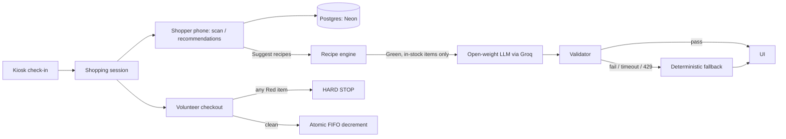

# HNLP: Medically Tailored Grocery (MTG) System

**Design, Verification & Team Report**
2026 NestforAwhile AI-Augmented Software Engineering Challenge · Team HNLP (HopefullyNotLastPlacers)

- **Repository:** https://github.com/EthanM-programin/HNLP
- **Submission link:** https://bit.ly/26NestforAwhileSol

---

## Evidence at a Glance

> Add screenshots to `docs/images/` and update the file names below.

**Figure 1: Demo barcode sheet** (printable; scan from the Scan tab on a phone)


| Item | SKU | Eleanor | Marcus | Sarah | David | Aisha |
|---|---|:-:|:-:|:-:|:-:|:-:|
| Raw Unsalted Almonds | 071234567855 | 🟢 | 🔴 | 🟢 | 🟢 | 🟡 |
| Fresh Organic Spinach | 071234567801 | 🟢 | 🔴 | 🟢 | 🟢 | 🔴 |
| Cottage Cheese (Low-Fat) | 071234567888 | 🔴 | 🔴 | 🔴 | 🟢 | 🔴 |
| Raw Honey | 071234567872 | 🔴 | 🟢 | 🟢 | 🔴 | 🔴 |
| Bananas | 071234567823 | 🟡 | 🔴 | 🟢 | 🟡 | 🔴 |
| Shrimp (Peeled & Deveined) | 071234567894 | 🟢 | 🟢 | 🔴 | 🟢 | 🟢 |
| Low-Fat Plain Greek Yogurt | 071234567879 | 🟢 | 🟡 | 🟢 | 🟢 | 🔴 |
| Low-Sodium Canned Black Beans | 071234567826 | 🟢 | 🔴 | 🟢 | 🟢 | 🔴 |
| Chicken Breast (Boneless) | 071234567877 | 🟢 | 🟢 | 🟢 | 🟢 | 🔴 |
| Roma Tomatoes | 071234567802 | 🟢 | 🟢 | 🟢 | 🟢 | 🟢 |
| Cucumber | 071234567812 | 🟢 | 🟢 | 🟢 | 🟢 | 🟢 |
| Organic Eggs (Large) | 071234567886 | 🟢 | 🟢 | 🟢 | 🟢 | 🟢 |

🟢 Good pick · 🟡 Limit · 🔴 Put it back

*Tip: raise screen brightness and hold the phone 15–25 cm from the screen. Camera scanning needs Chrome on Android; on iPhone, type the number under the barcode.*

**Figure 2: Check-in, scan, and hard-stop** (client CLI-1002 checks in, scans almonds → RED, checkout validation → `HARD_STOP`)


**Figure 3: AI harness results**


**Figure 4: Running application**


---

## 1. Project Overview

The MTG system is an in-person, client-choice warehouse application for **Epic Cure** (St. Augustine, FL), built for the Food is Medicine initiative. Clients with chronic conditions (Type 2 Diabetes, Hypertension, Chronic Kidney Disease) shop with a physical cart while the software enforces clinical guardrails and offers culinary guidance.

It follows a two-layer architecture:

- **System of Record:** a deterministic Spring Boot web application and Postgres database holding clients, encrypted medical profiles, inventory, sessions, and checkout logs.
- **System of Intelligence:** an open-source LLM that only writes recipe suggestions. It never decides whether a food is safe.



## 2. Core Design Principle: Safety Is Deterministic, AI Is Advisory

All clinical approve/restrict logic lives in the backend rules engine and the SQL dietary matrix. A hallucination can therefore never approve a dangerous food, and the UI stays responsive if the AI endpoint lags or returns bad JSON in the middle of the warehouse.

- The LLM receives only **already-approved (Green), in-stock** items and the client's dietary constraints, strictly for natural-language recipe synthesis and missing-ingredient suggestions.
- Its output is wrapped in a strict JSON schema validator.
- A **3-second timeout** (or HTTP 429 rate limit) triggers a fallback to pre-cached or deterministic recipes so the floor never stalls.

## 3. Architecture

| Layer | Technology | Notes |
|---|---|---|
| Presentation | Kiosk, shopper phone page, volunteer and manager screens | Kiosk and shopper pages public; volunteer and manager pages behind login |
| Application (MVC) | Java / Spring Boot (Maven) | `SessionController`, `WarehouseController`; services for check-in, queue, session, shopper, stock, restock, checkout, analytics |
| Rules engine | `RulesEngine`, `Ruleset`, `Flag`, `FlagResult` | Pure deterministic logic; unit-tested |
| AI integration | `GroqClient`, `RecipeEngine`, `RecipeService`, `RecipeValidator`, `FallbackRecipes` | Open-weight model via Groq free tier |
| Database | Neon Postgres, Flyway migrations `V1__schema`, `V2__seed_data`, `V3__seed_fixes` | PHI encrypted via `EncryptedStringConverter` |
| Deployment | Render (Docker) + Neon | Secrets supplied only as environment variables |

### Tools and Services

| Tool | Status | Used for |
|---|---|---|
| Claude | Used | Architecture, rules-engine design, debugging, documentation |
| Gemini | Used | Research and brainstorming |
| VS Code Copilot | Used | Code generation and in-editor iteration |
| Groq (free tier, open-weight model) | Used | Runtime recipe synthesis |
| Neon Postgres | Used | Database |
| Render | Used | Hosting / public URL |
| OpenRouter (free models) | Planned, replaced by Groq | Original recipe-synthesis plan |
| GCP (Google Cloud) | Considered | Possible hosting |
| DigitalOcean | Considered, likely not used | Possible hosting |
| GrillMe | Considered | Prompt/design review |

## 4. Clinical Rules Engine

Each condition defines strict numeric nutrient limits **per serving** (e.g. `max_sodium_mg`, `max_sugar_g`, `max_potassium_mg`, `max_phosphorus_mg`) plus restricted allergen tags. At check-in (US-1.1) the engine builds the client's session ruleset:

1. Take the **strictest (minimum) ceiling** for each nutrient across all of the client's active conditions.
2. Take the **union** of all allergens.
3. Compare each catalog item's per-serving nutrition against that ruleset.

| Flag | Rule | Effect |
|---|---|---|
| 🔴 **Red (Restricted)** | Contains a restricted allergen, or exceeds 100% of any limit | Triggers the checkout hard stop (US-4.1) |
| 🟡 **Yellow (Capped)** | Within 80–100% of a limit | Allowed up to a household-scaled quantity |
| 🟢 **Green (Approved)** | Below 80% of all limits | Recommended |

**Example, CLI-1002 (Marcus, Renal & Kidney Health tier, household of 4):**
sodium ≤ 300 mg/serving, potassium ≤ 250 mg/serving, phosphorus ≤ 200 mg/serving, avoid tree nuts.
Grocery targets (tier amounts × household size): 12 lb produce, 6 lb protein, 2 dairy units, 4 lb grain. Almonds and spinach rate Red for this client.

### Data Model

> **Design update:** the original plan used a many-to-many `client_conditions` junction table (`clients 1 --< client_conditions >-- 1 clinical_conditions`, keyed by ICD-10 code). The final implementation instead stores **encrypted client medical profiles** linked to clinical conditions and dietary tiers, and thresholds are defined **per serving** (migration V3).

Main entities: `Client`, `ClientMedicalProfile`, `ClinicalCondition`, `DietaryTier`, `BiometricReading`, `Product`, `InventoryLot`, `BinLocation`, `ShoppingSession`, `CartItem`, `CheckoutLog`, `CheckoutLine`, `CheckoutOverride`, `AppSetting`.

**Seed data** (Flyway V2/V3): 100+ item product catalog with macronutrients, allergen flags, and bin locations; Clinical Rules Matrix for Diabetes, CKD, and Hypertension; 5 sample patient personas (Eleanor, Marcus, Sarah, David, Aisha).

## 5. API and Request Pipeline

Item scanning is decoupled from recipe synthesis so scans feel instantaneous and rate limits aren't blown.

1. **Zero-LLM barcode scans (US-3.1):** a pure database lookup (target < 50 ms) returns the deterministic Green/Yellow/Red status and updates the cart. The LLM is never called on a raw scan.
2. **On-demand / debounced recipe generation (US-3.2, US-3.3):** the LLM is called at session initialization and when the shopper taps "Suggest Recipes for My Cart" (or after a 5-second cart-change debounce). Responses are cached per cart hash.
3. **Constrained payload and schema validation:**
   - Only the top 15–20 in-stock, Green-approved items (with exact bin IDs) go into the prompt, so the model cannot invent out-of-stock ingredients.
   - Request JSON-object output (`response_format: { type: "json_object" }`) where the provider supports it.
   - Strip stray markdown code fences, then parse the reply.
   - Validate every ingredient against the client's Red list and every bin ID against live stock.
   - Fall back to a deterministic ingredient-match recipe on timeout (> 3 s), rate limit (429), or invalid output.

### Known Endpoints

| Method | Path | Purpose |
|---|---|---|
| POST | `/api/checkin` | Check in a client by code (`{"clientCode":"CLI-1002"}`) |
| POST | `/api/session/{sessionToken}/scan` | Scan or enter a SKU (`{"code":"071234567855"}`) |
| POST | `/api/checkout/{sessionToken}/validate` | Validate cart; returns `HARD_STOP` or OK |
| GET | `/api/admin/ai-harness?runs=N` | Run the AI safety harness |

*Add the remaining endpoints (recommendations, recipes, restock, analytics, CSV export) with exact URLs and JSON once confirmed.*

## 6. Warehouse Workflows

### Check-in and capacity queue (US-1.1, 1.2, 1.3)

- Verify the client is enrolled and not expired.
- Expire sessions with no activity for 45 minutes (self-healing queue).
- Count active shoppers. If the floor is full (max capacity 10), add the client as `WAITING` and show their position ("You are #3 in line"). Otherwise set the session `ACTIVE` and save the client's limits and Red list on it.
- Return grocery targets: tier amounts × household size.
- Sessions live in `shopping_sessions` with status `WAITING`, `ACTIVE`, `COMPLETED`, or `EXPIRED`, and a `last_activity_at` heartbeat updated on every scan. When a session completes or expires, the lowest-position waiting session is promoted inside a transaction, so abandoned carts never deadlock the floor.

### Scan and recommendations (US-3.1, 3.2)

- Scan: look up the product, use the saved limits to return color, reason, and location, update the heartbeat, and add to the cart. No AI call.
- Recommendations: the best Green items currently in stock on the floor, with aisle, shelf, and bin.

### Checkout and inventory (US-4.1, 4.3)

- **Hard stop:** before any decrement, validate every scanned SKU against the session's Red list. If any match, block completion and highlight the item in red on the volunteer screen. The volunteer must remove it before Complete unlocks.
- **Audit trail:** each removal is logged in `checkout_override`.
- **Atomic FIFO decrement:** inventory is split into `products` (the catalog) and `inventory_lots` (`lot_id`, `product_id`, `bin_location`, `quantity_remaining`, `received_at`, `expires_at`). Checkout runs in a single `BEGIN ... COMMIT` transaction using `SELECT ... FOR UPDATE` ordered by `expires_at ASC, received_at ASC`, so concurrent checkouts never oversell a lot. It writes `checkout_log` and `checkout_line`.
- Afterward, the first person in the queue is let onto the floor.

### Restock list (US-4.2)

Products low on the shelves plus lots expiring within 7 days (`expires_at <= CURRENT_DATE + 7 days`), sorted by aisle then bin.

### Analytics (Epic 5)

- Anonymized average change in blood sugar, blood pressure, and kidney function at baseline, 3 months, and 6 months (no names or IDs).
- Pounds distributed per funding stream, from `checkout_line`.
- CSV export.

## 7. Verification & Validation

**Strategy**

1. **Schema migration and seeding:** run Flyway migrations on Neon; confirm core tables and seed data (100+ products, rules matrix, 5 personas).
2. **Backend routes (System of Record):** check-in (capacity and ceilings), barcode scan (pure SQL, no LLM), and atomic checkout with hard stop.
3. **AI integration layer:** recipe synthesis wrapped in JSON validation and the 3-second fallback timer.

**Unit tests:** `RulesEngineTest` (five personas, e.g. CLI-1002 gets almonds and spinach as Red), `FallbackRecipesTest`, `RecipeValidatorTest`.

**AI safety harness:** runs a sample cart for each persona and confirms no recipe contains a restricted item.

```powershell
# Summary
Invoke-RestMethod "http://localhost:8080/api/admin/ai-harness?runs=1" |
  Select-Object runs, aiServed, fallbacks, restrictedCaughtByValidator, servedRestrictedViolations, avgLatencyMs, passed

# Per-persona detail
(Invoke-RestMethod "http://localhost:8080/api/admin/ai-harness?runs=1").cases |
  Select-Object persona, source, failure, latencyMs
```

| Metric | Result |
|---|---|
| Runs | 5 |
| AI-served responses | 0 |
| Fallbacks used | 5 |
| Restricted items caught by validator | 0 |
| Restricted items served | 0 |
| Average latency | 279 ms |
| Overall | **Passed** |

> **Note:** every case in this run used the fallback (`HTTP_ERROR`) because the AI API key was not set. This confirms the failure path is safe. Re-run with the key configured to validate AI-served recipes.

**Manual end-to-end check:** check-in → scan almonds (RED) → checkout validation → `HARD_STOP`.

## 8. Setup

Set these environment variables (never commit their values):

| Variable | Purpose |
|---|---|
| `DB_URL` | Neon JDBC connection string |
| `DB_USER` | Database user |
| `DB_PASS` | Database password |
| `ENCRYPTION_KEY` | Key for PHI column encryption |
| `GROQ_API_KEY` | Groq free-tier API key |

Then run from the `mtg` folder:

```powershell
cd mtg
.\mvnw.cmd spring-boot:run
```

On macOS/Linux use `./mvnw spring-boot:run`. The app starts on port 8080.

## 9. Team Roles and Collaboration

| Member | Responsibilities |
|---|---|
| **Ethan** | Backend, database, AI: rules engine and unit tests; check-in and queue; scan; recommendations; checkout and FIFO transactions; restock list; recipe engine (free open-weight models only, no paid credits); validation harness |
| **Teammate** *(add name)* | Frontend (kiosk, shopper phone page, volunteer checkout, restock screens); Epic 5 analytics dashboard and CSV export; security configuration (client, volunteer, and manager logins; public kiosk/shopper pages); Dockerfile and Render deployment |

**Working agreements**

- Agree the endpoint list (exact URLs and JSON) up front so both can work in parallel; frontend uses fake data until backend endpoints are ready.
- Log every prompt in `prompts.md` with who wrote it (chronological prompt evolution, iterations, and reflections).
- Pull before you push.
- Put the AI tool and development stage in every commit message.
- After the build: test the full demo together, then finish the README, reflection, slides, and rehearsal.

## 10. Submission Checklist

- [ ] `README.md` with all five required sections
- [ ] Source code in a **public** GitHub repo shared with organizers
- [ ] `prompts.md` prompt history log
- [ ] Supporting files: tests, sample inputs/outputs, execution screenshots/logs, evaluation notes
- [ ] 1–2 paragraph team reflection
- [ ] Live public URL verified; full demo rehearsed (7 min + 5 min Q&A)
- [ ] Package uploaded to https://bit.ly/26NestforAwhileSol before **9:00 AM, Sunday Nov 15**
