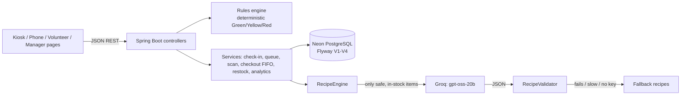

# HNLP: Medically Tailored Groceries (MTG) for Epic Cure

**Team HopefullyNotLastPlacers** · 2026 UNF NestforAwhile AI-Augmented Software Engineering Challenge

**Live demo:** TODO: https://HNLP.onrender.com
**Repository:** https://github.com/EthanM-programin/HNLP

---

## Project Overview

Epic Cure (St. Augustine, FL) runs a choice-based, "farmers market" food warehouse: clients walk the aisles and pick their own groceries, with no ID and no paperwork. They want to offer **Medically Tailored Groceries** for clients with chronic conditions (Type 2 diabetes, hypertension, chronic kidney disease) without making floor volunteers check every item by hand.

Our web app turns the warehouse into a guided, safe shopping experience:

| Who | What they get |
|---|---|
| **Client at the kiosk** | Enters a client code. Sees their diet plan, grocery targets for their household, or their place in line if the floor is full. |
| **Client on their phone** | Personalized "good picks" with aisle/shelf/bin, a barcode scanner that shows **Good pick / Limit / Put it back** instantly, a cart with +/− buttons, and AI recipes built from their cart (with missing ingredients and where to find them). |
| **Volunteer at the exit** | Scans the cart. Restricted items **hard-stop** checkout until removed (every removal is logged). Completing checkout decrements stock FIFO and prints a receipt. A restock route lists low floor bins in walking order and lots expiring within 7 days. |
| **Program manager** | Anonymized health trends (A1C, blood pressure, eGFR at baseline, 3 and 6 months), pounds distributed per grant, CSV exports, and a one-click AI safety check. |

**Core principle:** the AI never decides what is safe. A deterministic rules engine flags every item; the open-source LLM only writes recipes from items the rules engine already approved, and its output is validated again before anyone sees it.

### Requirements covered

| Epic | User stories | Where |
|---|---|---|
| 1. Check-in & flow control | US-1.1 check-in, US-1.2 recommendations, US-1.3 capacity queue | `CheckInService`, `QueueService`, `kiosk.html` |
| 2. Health & diet profile | US-2.1 encrypted profile, ICD-10 → tier | `ClientMedicalProfile` (AES-GCM), `RulesEngine` |
| 3. Point-of-choice loop | US-3.1 scan, US-3.2 matching, US-3.3 recipes | `ShopperService`, `RecipeEngine`, `shop.html` |
| 4. Inventory & safety | US-4.1 hard-stop, US-4.2 restock route, US-4.3 FIFO + expiry | `CheckoutService`, `RestockService`, `volunteer/checkout.html` |
| 5. Analytics | US-5.1 outcomes, US-5.2 grant attribution | `AnalyticsService`, `manager/dashboard.html` |

### Requirements we added
- **Self-healing queue:** abandoned carts expire after 45 minutes of inactivity; closing the shopper tab ends the visit after a 15-second grace period; the next person in line is promoted automatically.
- **End visit / leave the line** without taking anything (no stock change, not counted as a checkout).
- **Household-scaled limits** for "Limit" (Yellow) items: one unit per household member.
- **Fail-safe data:** if a product doesn't list a nutrient that the client is limited on, it can never be Green.
- **Small-cohort suppression** in analytics so individuals can't be singled out.
- **Accessible UI:** Atkinson Hyperlegible font (designed for low vision), flags use icon + words, not color alone.

---

## Setup Instructions

### Requirements
- Java 17+ (we used 17 and 21), Git
- A PostgreSQL database (we use **Neon**, free tier)
- Optional: a free **Groq** API key for AI recipes (without it, the app uses standard recipes)

### 1. Clone
```bash
git clone https://github.com/EthanM-programin/HNLP.git
cd HNLP/mtg
```

### 2. Environment variables (never commit these)
| Variable | Purpose |
|---|---|
| `DB_URL` | `jdbc:postgresql://<host>/<db>?sslmode=require` (must start with `jdbc:`) |
| `DB_USER`, `DB_PASS` | Database login |
| `ENCRYPTION_KEY` | Secret used to encrypt medical data (all instances must share the same one) |
| `GROQ_API_KEY` | Free Groq key (optional) |
| `VOLUNTEER_PASSWORD`, `MANAGER_PASSWORD` | Staff logins (default to `volunteer` / `manager` locally) |

Windows (permanent; restart VS Code afterwards):
```powershell
setx DB_URL "jdbc:postgresql://<host>/neondb?sslmode=require"
setx DB_USER "<user>"
setx DB_PASS "<password>"
setx ENCRYPTION_KEY "<long random string>"
setx GROQ_API_KEY "<gsk_...>"
```

### 3. Run
```bash
./mvnw spring-boot:run          # Windows: .\mvnw.cmd spring-boot:run
```
Flyway creates the schema and seed data (V1–V4) on first start; `ProfileSeeder` writes the 5 encrypted patient profiles. Open http://localhost:8080.

### 4. Try it
| Screen | URL | Login |
|---|---|---|
| Home | `/` | none |
| Kiosk | `/kiosk.html` | client code, e.g. `1002` |
| Shopper app | `/shop.html` | client code |
| Volunteer checkout & restock | `/volunteer/checkout.html` | `volunteer` / `volunteer` |
| Manager dashboard | `/manager/dashboard.html` | `manager` / `manager` |
| Demo barcodes | `/barcodes.html` | none |

**Sample clients:** `1001` Eleanor (diabetes + hypertension), `1002` Marcus (CKD + tree nut allergy), `1003` Sarah (hypertension + shellfish allergy), `1004` David (diabetes), `1005` Aisha (CKD + diabetes + dairy allergy).

**Demo script:** check in `1002` → scan almonds `071234567855` (Red: tree nut allergy) → volunteer checkout `CLI-1002` shows the hard-stop → remove it → complete → manager dashboard shows the pounds by grant. Floor capacity is set to 4, so a 5th check-in shows the queue.

### 5. Tests
```bash
./mvnw test
```
`RulesEngineTest`, `RecipeValidatorTest`, `FallbackRecipesTest` (pure unit tests). `MtgApplicationTests` needs the database variables.

### 6. Deploy (Render, free, no card)
New Web Service → this repo → **Root Directory** `mtg` → **Runtime** Docker → **Instance** Free → add the environment variables above. The `Dockerfile` builds with Maven and runs on Java 21 with a heap sized for 512 MB.

---

## Tool Usage Summary

| Component | Tools | Why |
|---|---|---|
| Planning & architecture | **Claude (web)** | Turned the problem case into an epic dependency plan, data model, and build order; reviewed our team design doc and caught gaps (see `prompts.md`) |
| Database schema & seed | **Claude (web)**, **Gemini** (seed SQL first draft) | Claude generated `V1__schema.sql` and entities; Gemini drafted the 100-item seed, which Claude reviewed and corrected in `V3__seed_fixes.sql` |
| Backend (Spring Boot) | **Claude (web)** | Rules engine, services, repositories, controllers, unit tests |
| Debugging & integration | **Manual edits**, **GitHub Copilot** (TODO: confirm) | Environment setup, Groq model swap, merge conflicts |
| Frontend | **Claude (web)** | Plain HTML/CSS/JS pages, verified in a headless browser against a mock API before delivery |
| AI layer (runtime) | **Groq free tier**, **`openai/gpt-oss-20b`** (open weights, Apache 2.0) | Fast, free, supports JSON mode. Originally `llama-3.1-8b-instant`; it was retired mid-hackathon (HTTP 404), so we switched models with one config change |
| Database hosting | **Neon** (free PostgreSQL) | Free, serverless Postgres; Flyway owns the schema |
| App hosting | **Render** (free web service, Docker) | Free, no credit card, public HTTPS URL (needed for phone camera scanning) |
| Source control | **GitHub** | Commit messages tag the tool and stage, e.g. `[Claude web] ...` |

### How the AI model was selected and integrated
- **Requirements:** open weights, zero cost, JSON output, fast enough for a shopper standing in an aisle.
- **Integration:** `GroqClient` calls the OpenAI-compatible endpoint with `response_format: json_object`, a 6-second timeout, and `reasoning_effort: low` for gpt-oss.
- **Privacy:** no diagnoses or identifiers are sent; the prompt only contains a plain-language diet focus ("low potassium, max 250 mg per serving") and product names/ids.
- **Safety:** see the Software Engineering Strategy below.

---

## Team Collaboration

| Member | Role |
|---|---|
| **Ethan Manuel** | Backend, database & AI integration: Neon setup, ran and verified the backend, debugged the Groq integration (model retirement, `reasoning_effort` fix), AI safety harness results. TODO: add anything else Ethan owned |
| **Aleksander Ara** | Frontend, kiosk/scanner flows & analytics: kiosk, shopper app, volunteer checkout & restock, manager dashboard, security/login, Render deployment. TODO: confirm |

**How we worked together**
- Wrote a shared design doc (`docs.md`) first: deterministic safety vs. LLM generation, the Green/Yellow/Red thresholds, the self-healing queue, FIFO locking. We reviewed it with Claude before generating any code, which caught a threshold gap and a PHI exposure (see `prompts.md`).
- Agreed on the API contract (`docs/API.md`) so frontend and backend could be built in parallel.
- Both members reviewed prompts before sending them and logged them in `prompts.md`.
- Shared one Neon database and one encryption key; secrets were passed privately, never committed.
- Pulled before every push; small commits tagged with the tool and stage.

TODO: add one or two real moments of shared decision-making (e.g. how you decided on capacity 4, Render vs Google Cloud, Groq model).

---

## Software Engineering Strategy

### Architecture



**System of Record:** Spring Boot 4 (Java 17), Spring Data JPA / Hibernate 7, Flyway, Spring Security, PostgreSQL.
**System of Intelligence:** open-weight LLM on Groq, wrapped so it can only add recipes, never change a safety decision.

### Key design decisions
1. **Safety is deterministic.** For each client, the strictest per-serving ceiling across all their conditions wins (MIN), and allergens are unioned. Red = allergen or >100% of a ceiling; Yellow = 80–100% (or a limited nutrient that isn't listed); Green = under 80%. Ceilings are per serving, derived from ADA, DASH/AHA and NKF daily guidance.
2. **PHI is encrypted.** ICD-10 codes and allergies are stored AES-256-GCM encrypted (`EncryptedStringConverter`). At activation they're reduced to numbers + allergen tags and frozen on the session (`ruleset_snapshot`), so scans never re-read PHI and rule changes can't flip a flag mid-visit. (We dropped the plain `client_conditions` junction table from our first design because it would have exposed diagnoses.)
3. **Queue that can't deadlock.** `Active_Floor_Shoppers` is counted, never stored. Check-ins and promotions serialize on a row lock; sessions expire on inactivity or when the tab closes; a scheduler promotes the next person every minute.
4. **Atomic FIFO checkout.** One transaction, `SELECT ... FOR UPDATE` on lots ordered by earliest expiry then arrival, floor bins first, products locked in id order to avoid deadlocks. Every lot drawn is recorded in `checkout_line` with its funding stream, which powers grant attribution.
5. **The hard-stop is enforced on the server.** The UI locks the Complete button, but `/complete` re-validates and returns 409 if anything Red remains.
6. **AI output is untrusted.** Only non-restricted cart items + the top 20 safe, in-stock items are offered to the model. Every returned recipe is dropped if it references a restricted, unknown or out-of-stock product id, has no steps, or ignores the cart. Bins come from our database, never from the model. Timeout, 429, bad JSON or "everything rejected" → deterministic fallback recipes. Successful AI results are cached per (ruleset hash + cart).

### Verification & validation
- **Unit tests (20):** strictest-ceiling merging, per-condition flags on real catalog values (spinach Red for CKD, Green for hypertension), allergen always Red, missing nutrient fails safe, ruleset snapshot round-trip, every validator rejection path, markdown-fence stripping, fallback recipes never use unlisted items. These tests caught a real bug before it shipped: a Java ternary that unboxed `null` and would have crashed check-in for every client with a condition.
- **Seed data validation:** the first seed (daily limits, 4 stocked products, plaintext PHI) was tested against a local Postgres: **all 100 products came out Green for every persona**. V3 fixed it; after the fix, the CKD persona gets 37 Green / 19 Yellow / 44 Red, 17 lots expire within 7 days and 14 floor bins need restocking.
- **AI safety harness** (`GET /api/admin/ai-harness`, also a button on the manager dashboard): runs the model for every persona with a realistic cart and independently re-checks what would be served. Pass = 0 restricted and 0 out-of-stock items served. Result: TODO: paste (aiServed x/5, restrictedCaughtByValidator, avgLatencyMs). With no key / retired model it still passed (5/5 fallback, 0 violations).
- **End-to-end smoke test** on a second machine: check-in (decryption + rules), almond scan → Red "Contains tree nuts", validate → `HARD_STOP`, harness → passed.
- **UI verification:** every page was rendered in headless Chrome against a mock API; screenshots caught a CSS class collision and a cramped scan result before delivery. Demo barcodes were decoded from a screenshot of the page (12/12 exact).

### Known limitations
- Per-serving ceilings are team assumptions from published daily guidance; a dietitian should review them.
- Staff accounts are in-memory (two roles) for the prototype.
- The pending "tab closed" registry and the recipe cache are in memory (single instance).

Assumptions (warehouse grid, rules matrix, personas) are documented in `docs.md`; the full API in `docs/API.md`; the prompt history in `prompts.md`.
